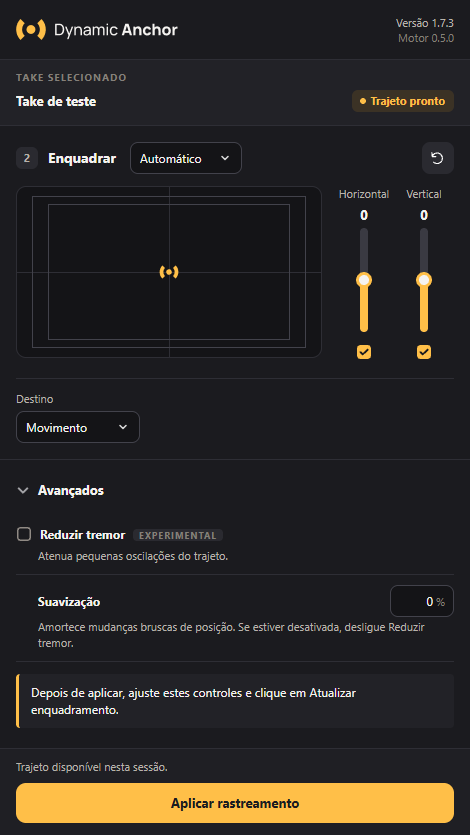

<div align="center">
<picture>
  <source media="(prefers-color-scheme: dark)" srcset="assets/logo-dark.svg">
  
</picture>
<p><strong>Mantenha o rosto ou o ponto de interesse no quadro.</strong></p>
<p><a href="https://github.com/eusouored/dynamic-anchor/releases/latest"><strong>Baixar para Windows</strong></a> · <a href="https://github.com/eusouored/dynamic-anchor/releases">Ver versões</a></p>
<p>Windows 10 ou 11 (64 bits) · Premiere Pro 26.0 ou mais recente</p>
</div>

Painel para o Adobe Premiere Pro (Windows) que acompanha um rosto (ou uma máscara rastreada do próprio Premiere) e enquadra o vídeo automaticamente, gravando os keyframes de posição e escala direto no clipe da timeline.

- **Rosto:** um motor local analisa o take selecionado, você escolhe a pessoa quando há mais de uma, e o enquadramento segue a cabeça inteira (rosto e cabelo).
- **Máscara:** usa o trajeto de uma máscara rastreada no Premiere, lido do projeto salvo.
- **Enquadrar:** zoom automático (sem bordas), fixo ou sem zoom; posição do alvo no quadro ou pelos sliders; destino em Movimento ou num Transformar próprio, com desfoque de movimento (0°, 180°, 360° ou ângulo livre).
- **Conferir:** cobertura do take, trechos sem medição e navegação até cada um antes de aplicar.
- Nada sai do computador: o motor só lê o arquivo de vídeo e responde em `127.0.0.1`.

## Instalação

Baixe o instalador na [versão mais recente](https://github.com/eusouored/dynamic-anchor/releases/latest) e siga as telas. Ele usa o instalador oficial da Adobe que vem com o Creative Cloud. Depois, abra o Premiere e abra o painel **Dynamic Anchor** pelo menu **Janela**.

Requisitos: Windows 10 ou 11 (64 bits) e Premiere Pro 26 ou mais novo. A GPU é usada pelo modelo de cabeça (DirectML) quando disponível; sem ela, o motor usa a CPU.

## Como funciona

| Parte | O que faz |
| --- | --- |
| Painel (`plugin/`) | UXP. Lê a seleção e o formato da sequência, pede a análise ao motor, mostra a cobertura e grava os keyframes pela API do Premiere |
| Motor de rosto (`motor/`) | Serviço HTTP local (porta 47833). YuNet detecta os rostos, um rastreador segue só a pessoa escolhida, e um modelo de segmentação mede a cabeça inteira em cada quadro |

O painel liga o motor sozinho na primeira análise. **Preparar motor** abre uma janela que confere a instalação e mostra cada passo; o relatório fica em `%LOCALAPPDATA%\Dynamic Anchor\motor-rosto\diagnostico.txt`.

Na versão 1.7.0 a análise ficou de 20% a 25% mais rápida, com o mesmo resultado quadro a quadro: o vídeo é lido por dois decodificadores que se alternam, a detecção de rosto roda numa etapa própria e a parte sem estado da medição da cabeça roda em paralelo, antes da etapa ordenada.

Na versão 1.7.4 (motor 0.5.1) o rastreador ganhou uma guarda de identidade: todo rosto visto no mesmo quadro que a pessoa escolhida é acompanhado como outra pessoa e nunca assume o lugar dela, e a comparação de aparência passou a usar também a cabeça (cabelo, boné, chapéu), além do rosto e da roupa. Quando não dá para confirmar a pessoa, o motor registra a perda em vez de trocar. A mesma versão tira a tremida localizada (na passagem entre detector e fluxo óptico e nos quadros em que o contorno da cabeça vem do rosto) com um ajuste centrado que não atrasa o movimento.

Na versão 1.7.5 (motor 0.5.2), foi corrigido o erro `list index out of range` na revisão de oclusões ao final do take e a seleção de origem que podia voltar indevidamente para Rosto.

## Interface

<div align="center">
<picture>
  <source media="(prefers-color-scheme: light)" srcset="assets/interface-light.png">
  
</picture>
<p><em>Ajuste a posição do alvo, o zoom e a suavização antes de aplicar o rastreamento.</em></p>
<p>Capturas com dados de demonstração · <a href="assets/interface-dark.png">Tema escuro</a> · <a href="assets/interface-light.png">Tema claro</a></p>
</div>

### Correções mantidas na versão 1.7.5

O painel recupera a seleção ao voltar ao foco e, enquanto está visível e ocioso, confere a cada 2,5 segundos se o take mudou. A conferência não lê efeitos, keyframes ou mídia, nem exporta frames. A leitura completa só é pedida quando há mudança ou uma seleção incompleta. As consultas param durante operações, com o painel oculto e ao descarregar.

A entrada do resultado também trata leituras reais de recuperação de perda que caem no mesmo quadro da sequência, como em mídia 59,94 fps numa sequência de 30 fps. Mantém a leitura válida mais próxima do quadro e preserva as coordenadas do trajeto. Leituras inválidas e duplicatas fora desse caso continuam sendo recusadas. Os algoritmos de rastreamento e os modelos permanecem os mesmos.

### Proteções de inicialização e encerramento

Ao restaurar a área de trabalho, o painel aguarda um clique ou uma tecla dentro dele. Passar o mouse, receber foco ou simplesmente abrir o Premiere não ativa as consultas de seleção ou de status. A conferência de seleção não inicia o motor.

O motor só é iniciado por uma ação explícita, como Analisar rosto, Iniciar motor ou Preparar motor. O serviço observa os processos do Premiere presentes na sua sessão do Windows quando inicia. Quando todas as instâncias vinculadas encerram, ele cancela o trabalho em andamento, fecha a conexão local e termina, inclusive se o Premiere sair inesperadamente. Não depende de uma mensagem de fechamento enviada pelo painel ou de contatos periódicos pela rede. Sem um Premiere aberto ou sem conseguir monitorá-lo, o serviço não inicia. Abra o Premiere antes de ligar ou preparar o motor.

A revisão continua em 1.7.5 / motor 0.5.2. O painel exige a proteção `premiere-process-lifetime-v1` para aceitar o motor; uma cópia anterior, mesmo numerada 0.5.2, precisa ser substituída. Os algoritmos de rastreamento e os modelos foram preservados.

## Estrutura

| Pasta | Conteúdo |
| --- | --- |
| `plugin/` | O painel UXP (`manifest.json`, `index.html`, CSS, JS, ícones e o projeto-modelo do Premiere em `assets/`) |
| `motor/fontes/` | Código do motor de rosto (Python 3.12) e os testes dele (`motor/fontes/testes/`) |
| `motor/bat/` | `iniciar-motor.bat`, `parar-motor.bat` e `preparar-motor.bat`, que vão ao lado do motor empacotado |
| `motor/testar_http.py` | Compara dois executáveis do motor pelo HTTP, como o painel faz |
| `instalador/` | Instalador para Windows (C#, .NET Framework 4) e o gerador `gerar_instalador.py` |
| `ferramentas/` | Empacotador do `.ccx` e utilitários dos ícones (SVG compatível com o UXP, limpeza de metadados) |
| `testes/` | Simulador do painel (Premiere simulado) e os testes automáticos |

## Rodar o motor a partir das fontes

O pacote distribuído leva o motor já empacotado (PyInstaller). Para rodar as fontes, use Python 3.12 com `opencv-python` 5.0, `numpy` 2.5, `onnxruntime-directml` 1.24 (ou `onnxruntime`) e `mediapipe` 1.1, e ponha na pasta `motor/fontes/` os modelos, que não fazem parte do repositório (estão no pacote das Releases):

- `face_detection_yunet_2023mar.onnx` (YuNet, MIT);
- `head_parsing_resnet18.onnx` e `head_parsing_resnet18_labels.onnx` (segmentação de cabeça; veja Licença);
- `face_landmarker-v1.task` (MediaPipe, Apache-2.0).

```bash
python motor/fontes/anchor_servico.py
```

Testes do motor:

```bash
python -m unittest discover -s motor/fontes/testes
```

## Testes do painel

Não precisam do Premiere: `testes/harness.js` carrega o `index.html` e o JS reais num Chromium e simula o Premiere, a seleção e o motor. Precisam do Playwright (`npm install playwright`, ou `PLAYWRIGHT` com o caminho do pacote) e do Chrome (`CHROME_PATH`, se não estiver no lugar padrão).

```bash
node testes/botoes.js
```

Explorador de botões: confere a função de cada controle no que é entregue ao Premiere simulado e clica todos os controles visíveis em cada estado.

```bash
node testes/capture.js
node testes/tamanhos.js
node testes/alinhamento.js
```

Capturas nos dois temas, 136 tamanhos de painel e alinhamento das linhas.

```bash
node testes/motor-real.js <anchor-motor.exe> <video> <início> <fim> <pasta-de-saída>
```

Ponta a ponta com o motor real: o painel analisa um take de verdade, escolhe a pessoa, confere e aplica.

## Empacotar

1. Ponha o motor empacotado em `motor/motor-rosto/` (pasta `anchor-motor/` com o `.exe` e o `_internal`, mais os `.bat` de `motor/bat/`).
2. `python ferramentas/empacotar_ccx.py plugin motor/motor-rosto dist/Dynamic-Anchor-<versão>.ccx`
3. `python instalador/gerar_instalador.py instalador/anchor.json` (usa o `csc.exe` do .NET Framework 4).

## Licença

Código do Dynamic Anchor: MIT com a condição "Commons Clause" v1.0 (`LICENSE`). Uso, estudo e modificação liberados; venda do software não. Não é uma licença de código aberto no sentido da OSI.

Os componentes de terceiros mantêm as próprias licenças (lista completa em `plugin/TERCEIROS.txt`). Os principais:

- OpenCV (Apache-2.0) e a FFmpeg 7.1 que vem com ele (LGPL 2.1 ou posterior, sem partes GPL, como DLL separada). Código-fonte: FFmpeg 7.1 em ffmpeg.org e a receita do OpenCV em `opencv/opencv_3rdparty`.
- ONNX Runtime (MIT) e DirectML (licença da Microsoft que permite distribuí-lo dentro de aplicativos para Windows).
- MediaPipe, ONNX (Apache-2.0); NumPy (BSD); Python (PSF); PyInstaller (GPL-2.0 com exceção para o carregador).
- YuNet (MIT).
- **Modelo de segmentação de cabeça:** o código de origem é MIT, mas os pesos foram treinados no conjunto de dados CelebAMask-HQ, cujos termos restringem o uso a pesquisa e educação, sem fins comerciais. Sem esse modelo, o motor usa a referência do rosto (sem cabeça inteira).

Adobe e Premiere Pro são marcas da Adobe. Este é um projeto independente, sem afiliação nem endosso da Adobe.

## Outros plugins Dynamic

[Dynamic Cut](https://github.com/eusouored/dynamic-cut) · [Dynamic Captions](https://github.com/eusouored/dynamic-captions)

<sub>Projeto independente para Adobe Premiere Pro.</sub>
